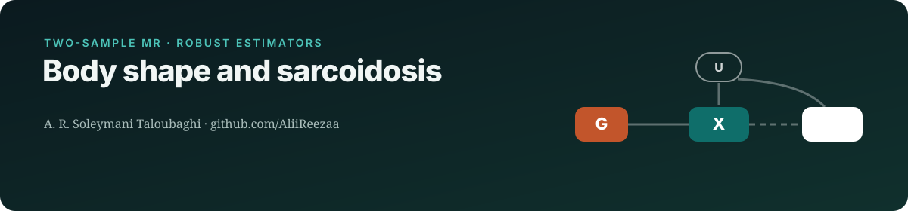
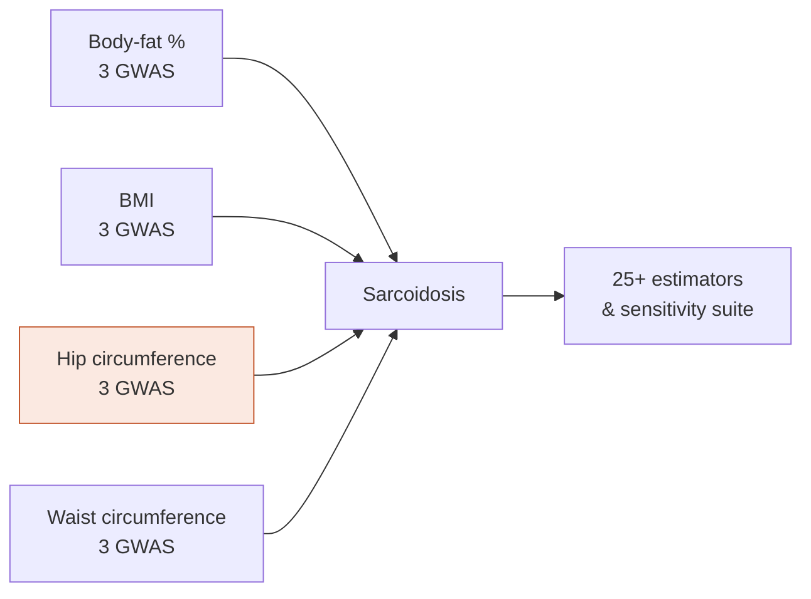

   

> **Status:** manuscript in preparation
>
> This repository is a public overview of an unpublished study. It shows the research question, design and methods. **Results, data and analysis code are withheld until peer-reviewed publication**, and will be released here at that point.

## Research question
Which measures of body size and fat distribution (body-fat %, BMI, hip and waist circumference) **causally** influence sarcoidosis risk?

## Study design

## Data sources
| Role | Dataset | Notes |
|---|---|---|
| Exposures | 12 anthropometric GWAS (IEU OpenGWAS) | 3 independent sources per trait |
| Outcome | Sarcoidosis GWAS (GWAS Catalog) | European ancestry |

## Methods
| Component | Approach |
|---|---|
| Primary | IVW random effects |
| Robust estimators | MR-RAPS, MR-Lasso, cML, contamination mixture, dIVW, and more |
| Diagnostics | Cochran Q, I², I²GX, MR-PRESSO, radial MR, Cook's distance, Steiger, leave-one-out |

## Why it matters
Obesity is a suspected risk factor for sarcoidosis. Separating overall adiposity from fat distribution points to more specific biology.

## Team & role
Co-author **A. R. Soleymani Taloubaghi** (analysis) with D. Habibi (corresponding) and colleagues.

## Reproducibility
- Analysis pipeline written in R 4.4 and Stata (mrrobust), with pinned package versions and a single entry-point script
- Public summary statistics only; no individual-level data is used or shared
- Reported according to STROBE-MR

---
Contact: <a href="mailto:alirezasoleymani24@gmail.com">alirezasoleymani24@gmail.com</a> · <a href="https://aliireezaa.github.io">aliireezaa.github.io</a>
